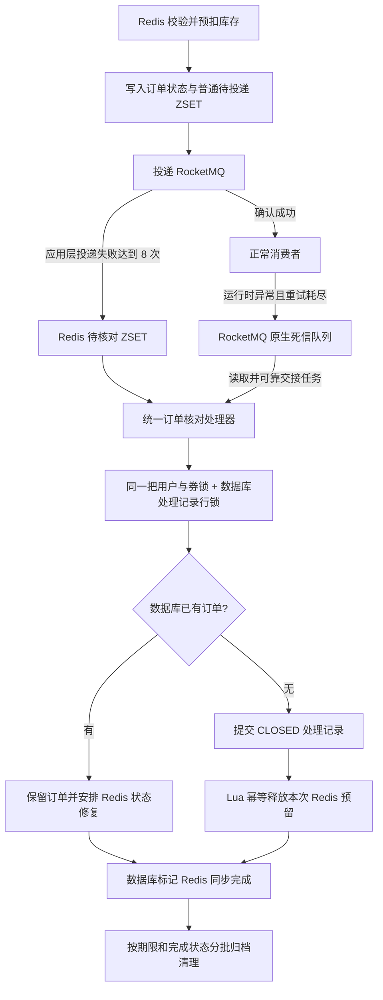

# 秒杀失败兜底设计

本文是待实现方案，按当前生活优选项目的 Redis 预扣、ZSET 投递、RocketMQ 消费、本地事务落库流程设计。本文没有修改业务代码、执行建表、部署监听器或运行故障测试。

保留“失败达到阈值后抢锁、查库、记录关闭、补偿 Redis、拦截迟到消息”的核心思路。关闭标记放在独立处理记录表，避免占用正式订单表的 `(user_id, voucher_id)` 唯一索引。正常消费者和关闭处理都在数据库事务内锁住同一条处理记录，Redis 锁用于减少竞争，数据库锁用于保证创建与关闭互斥。

## 流程



## 两张表各司其职

`tb_voucher_order` 保留真正创建的业务订单，保留现有用户与券的唯一索引。未落库订单失败时，不向它插入一条假的关闭业务订单。已落库订单的支付取消、退款、库存返还属于另一条业务流程，不在本方案里直接关闭。

新增 `tb_seckill_order_process` 保存少量处理信息。它同时是关闭标记、并发控制记录和 Redis 修复任务。建议字段：

| 字段 | 作用 |
|---|---|
| order_id，主键 | 同一次秒杀请求的身份；重复消息使用同一个 ID |
| user_id、voucher_id | 验证消息归属、获取用户与券锁 |
| decision | OPEN / SUCCESS / CLOSED，订单创建决策 |
| canonical_order_id | 实际业务订单 ID，支持已有有效订单的幂等映射 |
| redis_action | CONFIRM / RELEASE / RELEASE_DUPLICATE |
| redis_sync | PENDING / DONE / MANUAL，Redis 修复进度 |
| close_reason | 投递耗尽、消费耗尽、请求过期等原因 |
| created_at、expires_at、closed_at、updated_at | 原请求时间、允许创建订单的截止时间、关闭时间和更新时间 |
| sync_retry_count、next_retry_at、last_error | 修复失败后的重试调度和排查信息 |

主键使用 `order_id`，不对 `(user_id, voucher_id)` 建唯一索引。对 `(redis_sync, next_retry_at)` 和 `(decision, closed_at)` 建调度与清理索引。

正常消费也需要创建并锁住这一记录；不能仅在失败时插入关闭记录，让正常消费者无锁地查询“关闭记录不存在”。否则关闭记录的插入仍可能与订单创建并发提交。

所有建立、锁定记录的路径都采用一致顺序：用户与券的 Redis 锁 → 插入不存在的处理记录 → 数据库 `SELECT ... FOR UPDATE` → 查业务订单 → 完成数据库事务。插入冲突时只读取原记录，不覆盖它的身份、截止时间或最终状态。

## 正常消费者

消费者仍从消息显式取得 orderId/userId/voucherId。请求入口继续只写 Redis，不增加同步数据库操作。

1. 获取 `lock:order:{userId}:{voucherId}`。
2. 在一个数据库事务中，为该 orderId 建立 OPEN 处理记录，并锁定该行。校验已保存的用户、券及消息时间信息与当前消息一致。
3. decision 已是 CLOSED：不扣数据库库存、不创建订单；保留或安排待完成的 Redis 释放任务。
4. decision 已是 SUCCESS：幂等返回 canonical_order_id，并保留或安排 Redis 成功状态修复。
5. decision 为 OPEN：先查订单主键和相同用户、券的业务订单。
6. 已有实际订单：验证它的归属和实际业务状态，返回对应结果，不重复落库。
7. 没有实际订单：检查请求截止时间。已过期则提交 CLOSED 处理记录；未过期则扣数据库库存、插入订单，并在同一事务中将 decision 更新为 SUCCESS、redis_sync 更新为 PENDING。
8. 数据库提交后执行相应 Redis Lua；完成后将 redis_sync 更新为 DONE。

数据库异常继续抛给 MQ 重试。数据库决策已成功提交、仅 Redis 修复失败时，可由持久化的修复任务接手；只有确定任务已持久化，才允许正常结束 MQ 消费。数据库修复扫描任务是该交接的必要组成部分。

当前 `OrderWriter.persist()` 只返回订单 ID，`OrderMessageHandler` 随后无条件调用 `delivery.success()`。实现时应改为返回明确的决策、实际订单 ID 和 Redis 操作类型，避免 CLOSED 被错误地改成 SUCCESS。

## 发送端失败达到阈值

在 `seckill:status:{orderId}` 中增加 `publish_fail_count`、原请求创建时间和截止时间。

`defer` 的 Lua 只处理仍处于正常待投递状态的订单，原子完成以下操作：

- publish_fail_count 增加 1。
- 未达到 8 次：更新普通 outbox 的下一次投递时间。
- 达到 8 次：将 Redis 状态改为 RECOVERY_PENDING，加入 `seckill:recovery` ZSET，并从普通 outbox 移除。
- 已是成功或已完成关闭的记录：不再增加失败次数或重新加入队列。

8 表示 8 轮完整的应用层投递未取得成功确认，不是 8 次网络调用，也不等于“初次尝试加 8 次补发”。每次 syncSend 还可能包含 SDK 内部重试，应在配置说明中分别写明。

RECOVERY_PENDING 只是进入核对流程，不代表数据库已经判定订单失败。消息可能已经送达，正常消费者仍可能在创建订单。

恢复扫描器读取 recovery ZSET，调用统一核对处理器。数据库决策和修复任务提交成功后，才能确认 Redis 中的待核对任务已交接。数据库不可用时保留 Redis 任务，稍后重试；不能先退库存。

这一步不依赖“再往 MQ 发送一条死信消息”，因此 MQ 整体不可用时仍能处理。如果 Redis 中任务无法迁移到数据库，就保持原预留和任务，并记录告警；可靠性仍依赖现有 Redis 的持久化与恢复能力。

## 消费重试耗尽

保留现有 `maxReconsumeTimes=16`。重试耗尽后，Broker 将消息放入该消费组的原生死信 Topic：

```text
%DLQ%seckill_order_consumer_group
```

新增专用的死信读取流程，解析原订单消息后调用统一核对处理器。需要按当前 Broker、客户端版本配置死信 Topic 的读取权限和可靠的读取进度；不能假设原消费者会自动处理死信，也不能仅添加一个注解就认定已经接入。

数据库任务提交成功后才确认消息已交接或推进读取进度；交接失败则保留消息，恢复后重新处理。按 orderId 去重，所以与发送端 recovery ZSET 同时触发也只产生一个决策。

RocketMQ 的最大消费重试次数和应用投递失败阈值相互独立。消息超过业务截止时间时，正常消费者也可以进入关闭流程，不要求每个订单都必须等到 16 次重试耗尽。

## 统一核对与关闭

1. 取得与正常消费者相同的用户与券锁。
2. 在事务中建立并锁定同一条处理记录。
3. 查数据库主库，不将数据库超时当成“订单不存在”。
4. 实际订单已经创建：保持实际业务状态，安排 Redis 成功或相应终态修复，不因发送次数超限关闭它。
5. 实际订单不存在：将 decision 置为 CLOSED，redis_action 置为 RELEASE，redis_sync 置为 PENDING，提交事务。这个方案采用“失败耗尽后查库无单就关闭”的策略。
6. 提交后执行幂等 Redis 释放，成功则将 redis_sync 置为 DONE。

创建和关闭争用同一数据库行锁：创建先提交，关闭端会看到已有订单；关闭先提交，创建端会看到 CLOSED。即使 Redis 锁超时、丢失或实例故障，数据库行锁仍保护同一个 orderId 的决策。正式订单表的用户与券唯一索引继续保护不同 orderId 的有效订单。

CLOSED 记录已提交但 Redis 尚未释放时，不允许正常消费者把该记录变回 OPEN 或 SUCCESS。

## Redis 预留归属和补偿

保留当前买家 Set，再增加 `seckill:reservation:{voucherId}` Hash，字段为 userId，值为本次预留的 orderId。Lua 预扣时同时写入库存、买家 Set、预留归属、状态和 outbox。

释放 Lua 必须一次完成以下操作：

1. 校验必要 key 类型和预留归属，确认释放对象是本次 orderId。
2. 已有“释放完成”标记：返回已完成，不再增加库存。
3. 本次普通未落库订单关闭：库存增加 1，移除属于本次预留的买家资格和预留归属，写入 CLOSED/compensated 标记，清除普通 outbox 与 recovery 中的该订单。
4. 归属不同或预留信息缺失：不盲目增加库存、不删除用户的新购买资格；记录异常，进入核对或人工处理。

Redis Lua 完成后数据库 DONE 更新失败时，扫描器再次执行相同 Lua，由 Redis 标记保证库存不重复增加，然后补写数据库 DONE。

如果发现同一用户、同一券已有不同 orderId 的有效订单，不能直接按普通关闭流程删除其真实购买资格。需要 RELEASE_DUPLICATE 操作：只回收当前多余的预扣，并将买家与归属记录保留或修复为实际业务订单。原 Lua 通常会阻止重复预扣，这个分支处理 Redis 记录缺失等异常情况下的重复预留。

数据库明确库存不足是另一类异常，不能简单把 Redis 库存加 1 后继续接单。保留原有“停止该券继续接收虚假库存”的保护，并进行库存核对。不要用数据库当前库存直接覆盖 Redis：其他合法预扣仍可能尚未落库。

## Redis 修复扫描任务

固定批量扫描已作出 SUCCESS/CLOSED 决策且 redis_sync=PENDING、已到 next_retry_at 的记录，执行对应 Lua，成功后标记 DONE。推荐以 1 秒、每批 100 条作为调度起点，再根据积压实测调整；这只是设计初值，不是已经验证的最优参数。

失败采用退避调度，例如 5 秒、30 秒、1 分钟、5 分钟。多次失败或字段异常转为 MANUAL 并告警，不删除任务。多实例调度使用任务领取租约避免重复工作；租约失效仍以数据库决策和 Redis Lua 幂等保护结果，不依赖租约实现恰好执行一次。

## 用户能否重新抢购

未落库订单关闭并成功释放预留后，允许用户产生新的 orderId 再抢一次。

- 旧 orderId 的处理记录仍是 CLOSED，任何迟到消息都不能创建它。
- 新 orderId 可以建立新的 OPEN 处理记录。
- 关闭记录不在 tb_voucher_order 中，不占用用户与券唯一索引。
- 一旦已有实际业务订单，保留买家资格，继续执行一人一单规则。

如果业务规定失败也不允许重新抢购，应保留购买资格，另行明确规则；本方案默认允许尚未创建成功的订单重试抢购。

## 截止时间与每日清理

建议设置“该 orderId 最晚允许创建订单的时间”，例如首次请求后 30 分钟，并将其固定在请求状态、消息和处理记录中。这是业务策略初值；高积压或长停机情况下它会让未落库订单过期，需要明确接受这个行为。

截止时间不是从每次重试重新计算。重放消息不得延长它；消费者必须校验可信的原始时间，不能接受任意改写的 expiresAt。当前 ID 中带有生成时间，可据其验证原请求时间；旧消息没有新字段时应明确采用旧 ID 时间校验或人工迁移规则，不允许重新赋予新的有效期。

消费者在每次实际创建前检查截止时间。已经落库的订单仍按原业务状态幂等返回；没有订单且已过期的消息绝不能创建订单。这个规则是将来删除关闭标记后仍阻止旧消息重新下单的必要条件。

可以每天执行一次清理，但不直接删除“一天前关闭”的记录。推荐先保留 30 天，再根据故障停机、审计与人工重放规则调整；30 天本身不提供绝对安全保证，真正的保护是明确的消息过期规则与已完成的补偿。

待清理记录同时满足：decision=CLOSED、redis_sync=DONE、业务截止时间已过去、超过保留期、没有未完成的修复或核对任务。不能清理 OPEN、PENDING 或 MANUAL 记录。

每批按主键删除或归档，例如 500 条并短事务提交，使用清理索引控制锁和日志压力。删除前保留必要审计信息。若业务允许无限期重放并重新创建旧订单，就无法依靠固定期限删除关闭标记；应禁止旧 orderId 重新生效，新请求必须使用新 ID。

## 客户端查询

查到真实业务订单就返回实际订单；没有真实订单时再查处理记录和 Redis 状态。

| 状态 | 用户看到的结果 |
|---|---|
| PENDING / RECOVERY_PENDING | 正在处理或正在核对 |
| SUCCESS | 已创建订单，支付状态另看业务订单 |
| CLOSED 且 redis_sync=PENDING | 订单创建失败，预留释放处理中 |
| CLOSED 且 redis_sync=DONE | 订单已关闭；按业务规则可重新抢购 |
| MANUAL | 处理异常，等待核对 |

不能将查到 CLOSED 当作业务下单成功。MQ 消费正常结束仅表示消息处理完或任务已可靠交接。

## 需要改动的代码

- api 的 SeckillOrderMessage：加入不可变的原请求创建时间、截止时间及必要的消息版本。
- trade 的预扣 Lua：记录预留归属和原时间；defer Lua：计数并原子转移待核对任务。
- 新增处理记录实体、Mapper 和数据库升级脚本；在正常 OrderWriter 和关闭处理器内使用同一数据库行锁协议。
- OrderMessageHandler：区分成功、关闭、重复预留和修复待处理结果，替换无条件 success 调用。
- 新增原生死信读取流程、Redis recovery 扫描器、数据库 Redis 修复扫描器；共用核对和修复服务。
- 新增释放和重复预留修复 Lua，不直接复用当前将库存置零的 fail-order.lua。
- 扩展查询接口和配置项，增加异常数量、最长等待时间和人工核对告警。
- 建立完成状态归档清理任务，禁止删除尚未补偿的记录。

## 实现后的重点验证

1. 发送端连续失败 8 轮，普通 outbox 停止补发，recovery 记录仍可恢复；同时让 DB 不可用时任务不消失。
2. 发送超时但消费者已经落库，核对端只修复成功状态，不退库存。
3. 消费端重试耗尽，死信读取和任务交接失败后仍可重新读取。
4. 创建与关闭并发，以及 Redis 锁失效，数据库只能提交一个合法最终决策。
5. DB 已提交 CLOSED 后进程崩溃，修复扫描器继续释放 Redis。
6. Lua 已完成释放但 DB DONE 更新失败，多次执行只退一次库存。
7. 用户重新抢购后旧消息、旧补偿任务再次到来，不会误删新购买资格或增加库存。
8. 关闭记录按规则清理后，过期旧消息仍不能创建订单。
9. Redis 关键预留信息丢失时，不推测性地增加库存；保留异常记录进行核对。

## 上线与迁移顺序

先准备新增表和旧消息兼容策略，再停止或排空旧版投递器、消费者，清点现有 PENDING、普通 outbox 和死信记录。正常创建路径与关闭路径必须同时采用新行锁协议；不能让旧版消费者继续无视关闭标记地创建订单。

现有买家 Set 没有 orderId 归属信息，不能仅根据其中存在 userId 就认定它属于某条待补偿订单。对已落库订单可用数据库结果恢复归属；旧的未落库预留需要逐条核对或迁移，无法确认的记录进入人工核对，禁止批量增加库存。

明确处理旧消息缺失创建时间、截止时间的情况，然后启用新消费者与修复扫描器，最后开启发送失败计数转核对和死信交接。归档清理在创建前过期校验、任务修复与重放规则均落实后再启用。

本方案覆盖消息发送/消费失败和迟到消息的兜底。请求入口仍依赖 Redis 保存预留，没有改成数据库 outbox；Redis 整体数据丢失后的完整重建需要另行设计，不能仅靠上述补偿任务宣称已经解决。

## 官方依据

- [RocketMQ Push 消费、重试与死信说明](https://rocketmq.apache.org/zh/docs/4.x/consumer/02push/)。
- [RocketMQ 发送重试与重复消息说明](https://rocketmq.apache.org/docs/featureBehavior/05sendretrypolicy/)。
